<!-- CLAVE SOL · PERFIL GITHUB · IDENTIDADE VISUAL -->

  <a href="https://clavesol.com.br/">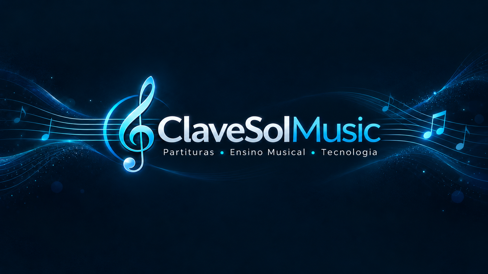</a>

  
  
  
  
  
  

<strong>MÚSICA PARA APRENDER, PRATICAR E COMPARTILHAR</strong>

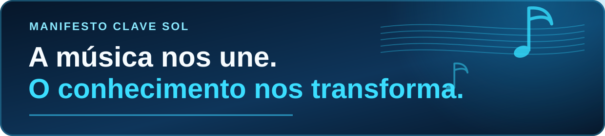

Sou <strong>Djames Suhanko</strong>. No <strong>Clave Sol</strong>, reúno partituras, conhecimento, ferramentas e aplicativos para quem aprende, ensina e toca. Meu trabalho conecta a prática musical ao desenvolvimento de software.

**Aprender. Tocar. Compartilhar.** Um espaço para estudar com atenção, experimentar boas ferramentas e compartilhar música — do primeiro exercício ao ensaio.

<!-- CLAVESOL-APPS:INICIO -->

  <a href="https://musicool.clavesol.com.br/">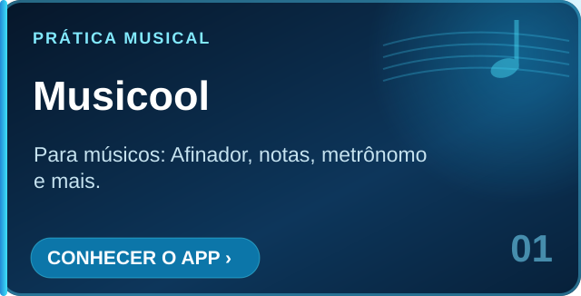</a>
  <a href="https://myluthier.clavesol.com.br/">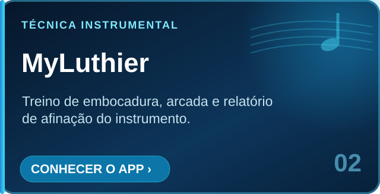</a>

  <a href="https://cantuscaeli.clavesol.com.br/">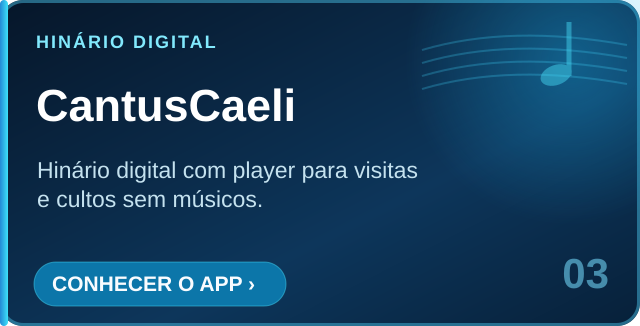</a>
  <a href="https://emet.clavesol.com.br/">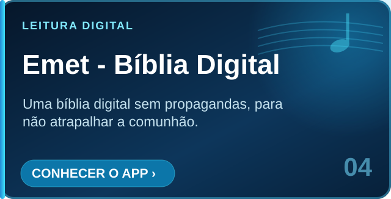</a>

  <a href="https://mose.clavesol.com.br/">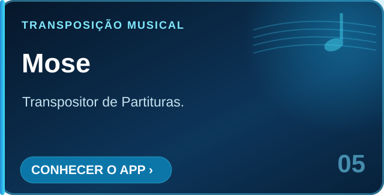</a>
  <a href="https://partitool.clavesol.com.br/">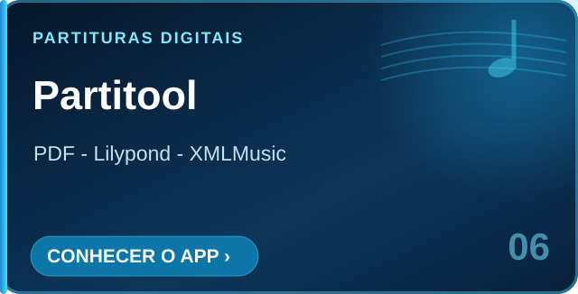</a>

  <a href="https://midi.clavesol.com.br/">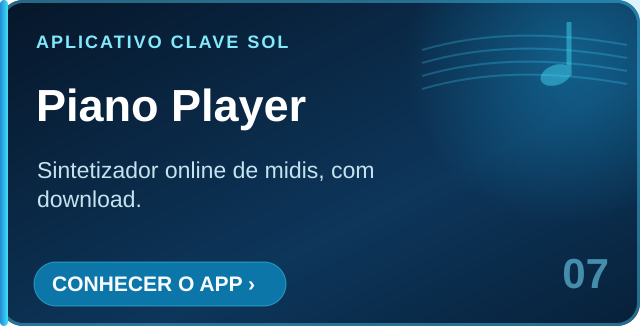</a>

<!-- CLAVESOL-APPS:FIM -->

<a href="https://clavesol.com.br/apps/"><strong>CONHECER TODOS OS APLICATIVOS · clavesol.com.br/apps →</strong></a>

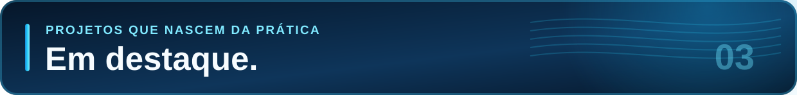

  <a href="https://partitool.clavesol.com.br/">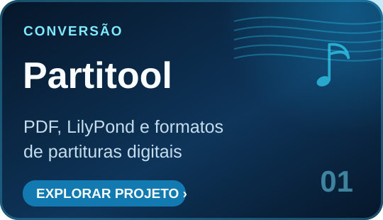</a>
  <a href="https://mose.clavesol.com.br/">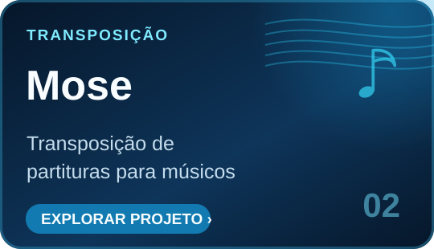</a>
  <a href="https://musicool.clavesol.com.br/">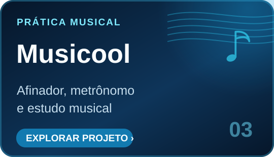</a>

  
  
  
  
  

Criação de aplicativos, transposição e conversão de partituras, interfaces e recursos digitais para músicos.

  <a href="https://clavesol.com.br/gem/">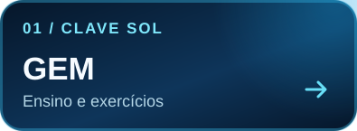</a>
  
  

  
  

  

<a href="https://clavesol.com.br/">clavesol.com.br</a> · Um espaço musical de Djames Suhanko.

